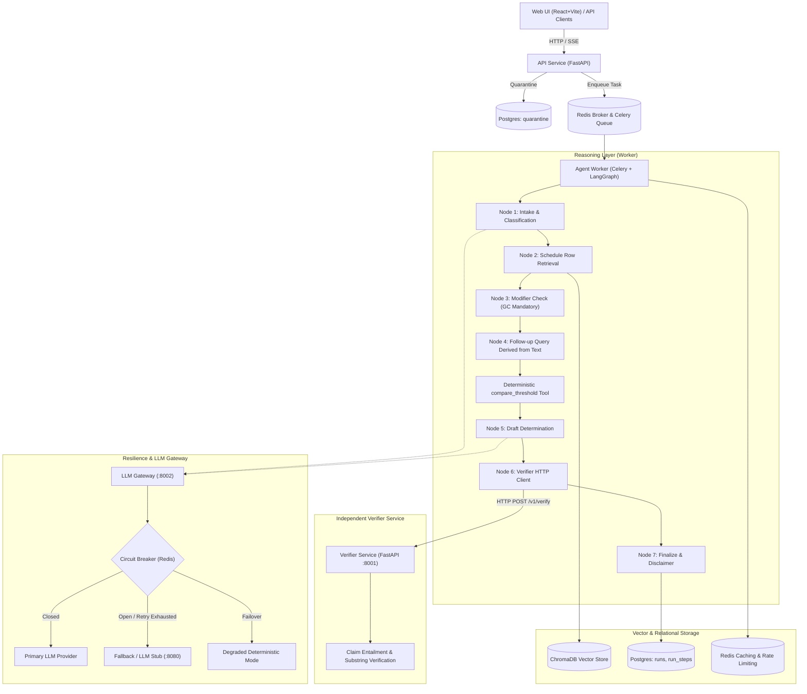

# System Architecture

---

## Microservices Boundaries & Justifications

1. **`api` (FastAPI)**:
   - Stateless, lightweight, scale-independent. Enforces request validation contracts, quarantines malformed inputs (HTTP 422), records feedback, and serves SSE status streams without blocking.
2. **`agent-worker` (Celery + LangGraph)**:
   - CPU/IO bound. Horizontal scaling via `docker compose up --scale agent-worker=3`. Executes multi-step retrieval, entity parsing, threshold arithmetic, and draft synthesis.
3. **`verifier` (FastAPI process on port 8001)**:
   - Separate failure domain with its own state schema and verification logic. Ensures the verifier is a genuine independent agent checking the draft against retrieved passages rather than an internal prompt in the same process.
4. **`llm-gateway` (FastAPI on port 8002)**:
   - Centralized choke point for all model interactions. Enforces timeouts, tenacity exponential backoff with jitter, shared Redis circuit breaker, and graceful degradation fallback.
5. **`llm-stub` (FastAPI on port 8080)**:
   - Deterministic, configurable latency/error stub for automated evaluations, continuous integration, and load testing.
6. **`retrieval-index` (ChromaDB server + one-shot Ingest CLI)**:
   - Serves dense embeddings and supports upsert/delete by ID.
7. **`redis`**:
   - Celery broker, whole-run cache, token-bucket rate limiter, and shared circuit breaker state.
8. **`postgres`**:
   - Durable store for screening runs, steps, feedback, quarantine records, and evaluation metrics.
9. **`web`**:
   - Multi-stage Nginx container serving React 18 / TypeScript / Tailwind CSS Single Page Application.
10. **Observability Stack**:
    - Prometheus, Grafana, OpenTelemetry Collector, Jaeger, and exporter sidecars.
